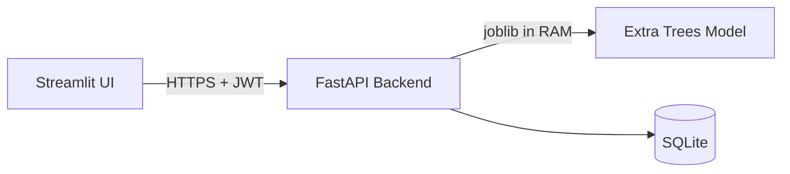
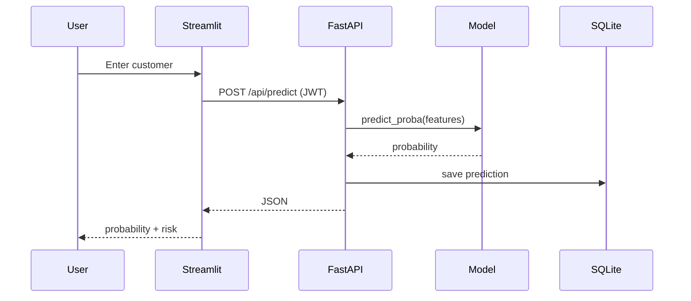

# Architecture

## Components

| Component | Technology | Responsibility |
|-----------|-----------|----------------|
| UI | Streamlit | Forms, uploads, charts, retention tasks |
| API | FastAPI | Auth, JWT validation, prediction proxy |
| Model | Extra Trees (sklearn) | Binary churn probability |
| DB | SQLite | Users, predictions, audit log |

## Prediction flow

